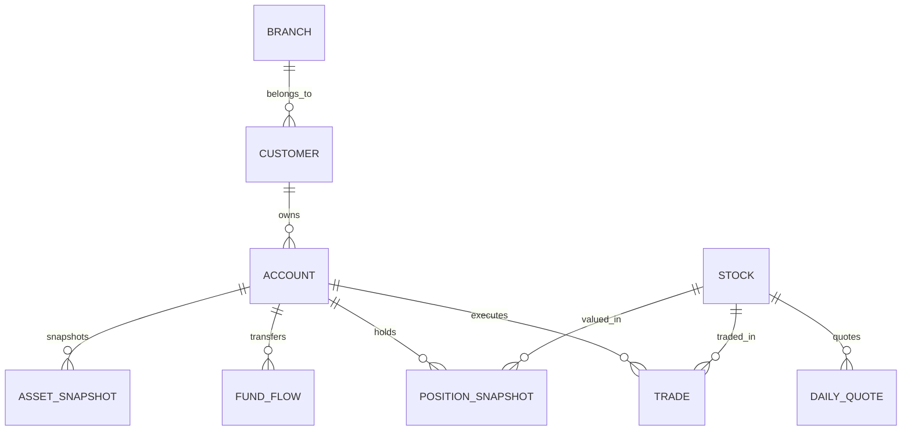

# Brokerage Retail Customer Analytics Database System

A database course project for brokerage headquarters and retail-customer management. The system covers **10 branches, 10,000 retail customers, and approximately 972,000 trades**. It supports branch comparison, customer activity and churn analysis, RFM segmentation, customer 360 search, stock popularity analysis, and transactional account-opening and order-placement demos.

The project uses **PostgreSQL, Python, and Streamlit**. Real market quotes are retrieved from AKShare. Customer and trading data are generated by configurable scripts under explicit business constraints and validated by a complete quality-check suite.

Original stock names and industries are retained in Chinese to preserve source-data fidelity. All synthetic customer names, branches, application text, documentation, and reports are in English.

## 1. Business Questions

The system addresses twelve groups of brokerage management questions:

- How do branches compare by customers, assets, and net fund inflows?
- How many customers are active, and which high-net-worth customers are becoming dormant?
- How are assets distributed across top, middle, and bottom customer tiers?
- Which stocks and industries receive the most customer trading activity?
- What do RFM segments and monthly customer-state transitions reveal?
- How can an advisor inspect one customer's assets, positions, unrealized P&L, and trade history?
- How can indexes improve query performance on nearly one million trade rows?

## 2. System Architecture

```text
Real market data from AKShare
        |
        v
fetch_quotes.py / fetch_stock_info.py
        |
        v
generate_data.py (five customer personas + cash/holding constraints)
        |
        v
CSV staging layer --> import_db_pg.py (PostgreSQL COPY)
        |
        v
PostgreSQL: nine relational tables + monthly snapshots + indexes
        |
        |-- queries_pg.sql: twelve business-analysis queries
        |-- benchmark_pg.py: index and scalability benchmarks
        |-- check_quality_pg.py: data-quality validation
        `-- Streamlit: six-page dashboard + account/order transactions
```

## 3. Database Design



| Table | Purpose |
|---|---|
| `branch` | Ten brokerage branches |
| `customer` | Customer profiles, risk levels, and branch assignments |
| `account` | Customer cash accounts |
| `stock` | Stock names, industries, and listing dates |
| `daily_quote` | Real daily market quotes |
| `trade` | Customer trade ledger |
| `fund_flow` | Cash transfer ledger |
| `position_snapshot` | Month-end holdings and weighted average costs |
| `asset_snapshot` | Month-end cash, market value, and total assets |

The core operational tables follow 3NF. The two snapshot tables are deliberately denormalized so monthly management reports do not repeatedly scan the full transaction history.

## 4. Data Methodology

### Real Data Layer

- Approximately one year of daily quotes for CSI 300 constituents: **300 stocks and 72,791 rows**;
- Industry and listing-date metadata for 300 stocks;
- CSV caching, retries, and resumable execution in the market-data ETL.

### Generated Data Layer

Five customer personas are simulated: regular investors, active traders, trend followers, dormant customers, and high-net-worth clients.

Every synthetic trade follows these rules:

1. It occurs on a real trading day;
2. Its price lies within the real daily low-high range;
3. Its volume is a multiple of 100 shares;
4. Cash is deposited before trading; purchases cannot exceed cash and sales cannot exceed holdings;
5. Month-end snapshots are aggregated from ledgers and real closing prices rather than generated independently.

### Quality Layer

`check_quality_pg.py` validates non-trading-day transactions, out-of-range prices, odd lots, amount mismatches, three types of orphaned foreign keys, negative cash balances, and overselling. The full dataset passes **all nine checks**.

## 5. Application Features

The Streamlit dashboard contains:

1. **Business Overview**: customers, total assets, monthly turnover, active accounts, and asset tiers;
2. **Branch Comparison**: asset rankings and net fund inflows;
3. **Customer Analytics**: activity rates, dormant high-net-worth customers, RFM, and state transitions;
4. **Stock Explorer**: turnover rankings, industry distribution, and real quotes;
5. **Customer 360**: customer assets, positions, unrealized P&L, and recent trades;
6. **Trade Simulator**: order placement, cash/holding validation, rollback demos, and account opening.

Order placement uses `SELECT ... FOR UPDATE` to lock the account row. Successful transactions are committed; insufficient cash or holdings trigger an explicit rollback.

## 6. Query Performance and Scalability

Each query is warmed up twice and measured five times, with the median reported. `EXPLAIN (ANALYZE, BUFFERS)` plans are saved as supporting evidence. The figures below come from a recorded run; exact timings vary by machine and database state.

| Benchmark | Scenario | Before | After | Result |
|---|---|---:|---:|---|
| B1 | Customer trade-history lookup | 50.16 ms | 0.17 ms | About 295x; sequential scan to index scan |
| B2 | Monthly turnover top 20 | 18.78 ms | 12.29 ms | Covering index enables index-only scan |
| B3 | One customer's last-90-day aggregation | 55.07 ms | 8.96 ms | About 6.1x faster |

For B4, the same aggregation takes approximately **22.1 / 83.8 / 123.2 ms** on **100,000 / 500,000 / 971,854 rows**, showing near-linear scaling.

## 7. Project Structure

```text
brokerage/
|-- app/
|   |-- Home.py                 # Business overview
|   |-- db.py                   # Connection and query helpers
|   |-- transactions.py         # Account-opening and order transactions
|   `-- pages/                  # Five additional dashboard pages
|-- scripts/
|   |-- fetch_quotes.py         # Market-data ETL
|   |-- fetch_stock_info.py     # Stock metadata retrieval
|   |-- generate_data.py        # Synthetic-data generation
|   |-- import_db_pg.py         # Schema creation and COPY import
|   |-- check_quality_pg.py     # Data-quality tests
|   `-- benchmark_pg.py         # Index and scalability benchmarks
|-- sql/
|   |-- schema_pg.sql           # Nine-table DDL
|   |-- queries_pg.sql          # Q1-Q12
|   `-- indexes_pg.sql          # Optimization indexes
|-- data/sample/                # Ready-to-import sample dataset
|-- requirements.txt
|-- .env.example
`-- README.md
```

## 8. Local Setup

### Requirements

- Python 3.11+
- PostgreSQL 14+
- Access to AKShare public data endpoints only when rebuilding the real-data layer

### Installation and Configuration

```bash
git clone https://github.com/yzhang9632/brokerage-customer-analytics.git
cd brokerage-customer-analytics
python -m pip install -r requirements.txt
```

Create the database:

```bash
psql -U postgres -c "CREATE DATABASE brokerage;"
```

Copy and edit the connection configuration:

```bash
cp .env.example .env
```

`.env` contains personal database credentials, is excluded by `.gitignore`, and must not be uploaded.

### Quick Demo with the Included Sample

`data/sample/` includes **100 customers, approximately one month of synthetic trades, and real quotes for 300 stocks**. No AKShare calls or data generation are required.

After creating the database and configuring `.env`, run:

```bash
python scripts/import_db_pg.py --sample
streamlit run app/Home.py
```

Use this mode to inspect the interface and transactions quickly. The sample is too small for reproducing benchmark figures.

### Rebuild the Full Dataset

```bash
python scripts/fetch_quotes.py
python scripts/fetch_stock_info.py
python scripts/generate_data.py --customers 10000 --months 12
python scripts/import_db_pg.py
python scripts/check_quality_pg.py
python scripts/benchmark_pg.py
```

Full data files are excluded from Git and can be reproduced with these scripts. Only the small sample is included in the repository. To regenerate the sample, run `python scripts/generate_data.py --customers 100 --months 1 --out data/sample`, then copy `data/raw/stock_info.csv` and `quotes_all.csv` into the same directory.

### Start the Dashboard

```bash
streamlit run app/Home.py
```

Open `http://localhost:8501` in a browser.

## 9. Testing and Validation

```bash
python scripts/check_quality_pg.py
python scripts/benchmark_pg.py
```

The transaction module covers successful purchases, insufficient-cash rollback, insufficient-holdings rollback, odd-lot rejection, and atomic account opening. The benchmark script is repeatable: it removes optimization indexes, measures the baseline, creates indexes, and measures the optimized queries.

## 10. Team Roles and Deliverables

- A: database design, DDL, indexes, and benchmarks;
- B: market-data ETL, synthetic-data generation, and quality validation;
- C: Q1-Q12 analytical SQL and metric definitions;
- D: Streamlit dashboard, transactions, video, and report integration.

The course video and PDF report are submitted separately through Canvas.

## 11. Metric Definitions and Limitations

- Customers and trades are synthetic teaching data and do not represent real brokerage clients;
- Trade amount equals price multiplied by volume; commissions and stamp duty are ignored;
- Turnover rate is simplified as monthly trade amount divided by month-end total assets;
- Snapshots represent a deliberate trade-off between normalization and reporting performance;
- Indexes are not always superior to parallel sequential scans for full-table aggregation; execution plans must be inspected;
- Real stock names and industries remain in Chinese to preserve source-data fidelity.
