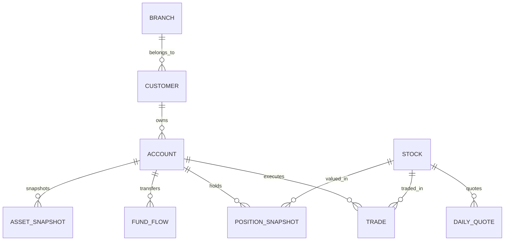

# 券商零售客户经营分析数据库系统

面向券商总部经营分析场景的数据库课程项目。系统覆盖 **10 个营业部、10,000 名零售客户、约 97 万笔交易**，支持营业部经营对比、客户活跃与流失分析、RFM 分层、客户 360 查询、股票热度分析以及开户/下单事务演示。

项目采用 **PostgreSQL + Python + Streamlit**。真实行情来自 AKShare；客户与交易数据由可配置脚本按业务规则合成，并经过完整质量校验。

## 1. 业务问题

系统围绕券商经营管理中的 12 类问题设计：

- 各营业部客户数、资产规模与银证转账净流入如何？
- 当前有多少客户活跃，哪些高净值客户正在沉睡？
- 客户资产在头部、腰部和尾部如何分布？
- 客户近期最爱交易哪些股票，成交额集中在哪些行业？
- 客户的 RFM 分层和月度状态迁徙有什么特征？
- 单个客户的资产、持仓、浮动盈亏和交易明细如何查询？
- 在接近百万行流水下，如何通过索引提升查询性能？

## 2. 系统架构

```text
AKShare 真实行情
        │
        ▼
fetch_quotes.py / fetch_stock_info.py
        │
        ▼
generate_data.py（五类客户画像 + 资金/持仓约束）
        │
        ▼
CSV 中间层 ──► import_db_pg.py（PostgreSQL COPY）
        │
        ▼
PostgreSQL：9 张关系表 + 月度快照 + 索引
        │
        ├── queries_pg.sql：12 条经营分析 SQL
        ├── benchmark_pg.py：索引与规模基准
        ├── check_quality_pg.py：数据质量检查
        └── Streamlit：6 页看板 + 开户/下单事务
```

## 3. 数据库设计



| 表 | 用途 |
|---|---|
| `branch` | 10 个营业部 |
| `customer` | 客户资料、风险等级、所属营业部 |
| `account` | 客户资金账户 |
| `stock` | 股票名称、行业、上市日期 |
| `daily_quote` | 真实日线行情 |
| `trade` | 客户成交流水 |
| `fund_flow` | 银证转账流水 |
| `position_snapshot` | 月末持仓与加权成本 |
| `asset_snapshot` | 月末现金、持仓市值与总资产 |

基础业务表采用 3NF；两张快照表属于刻意的反规范化设计，用于避免经营报表重复扫描全部历史流水。

## 4. 数据方案

### 真实层

- 沪深300成分股近一年日线：**300 只股票、72,791 行**；
- 股票行业与上市日期：300 只股票；
- 行情 ETL 支持 CSV 缓存、失败重试和断点续跑。

### 生成层

五类客户画像：定投、活跃、趋势、沉睡、大户。

每笔合成交易均满足：

1. 只发生在真实交易日；
2. 成交价位于当日真实最低价与最高价之间；
3. 数量为 100 的整数倍；
4. 先入金后交易，买入不超现金、卖出不超持仓；
5. 月末快照由流水与真实收盘价聚合生成。

### 质量层

`check_quality_pg.py` 检查：非交易日成交、成交价越界、非整手、金额不一致、三类孤儿外键、现金负余额和卖出超持仓。全量数据 **9 项检查全部通过**。

## 5. 应用功能

Streamlit 看板包含：

1. **经营总览**：客户数、总资产、当月成交额、活跃账户与资产分层；
2. **营业部对比**：资产排名与银证转账净流入；
3. **客户分析**：活跃率、沉睡高净值名单、RFM 与状态迁徙；
4. **股票热度**：成交额 TOP20、行业分布与真实行情；
5. **客户查询**：客户 360、持仓浮盈与交易明细；
6. **模拟下单**：买卖下单、资金/持仓校验、失败回滚及开户事务。

下单事务使用 `SELECT ... FOR UPDATE` 锁定账户，成功才提交；余额或持仓不足时显式回滚。

## 6. 查询性能与可扩展性

基准方法：每条查询热身 2 次，正式计时 5 次取中位数，并保存 `EXPLAIN (ANALYZE, BUFFERS)` 执行计划。

| 基准 | 场景 | 优化前 | 优化后 | 效果 |
|---|---|---:|---:|---|
| B1 | 客户交易明细点查 | 50.16 ms | 0.17 ms | 约 295 倍，Seq Scan → Index Scan |
| B2 | 月度成交额 TOP20 | 18.78 ms | 12.29 ms | 覆盖索引实现 Index Only Scan |
| B3 | 单客户近 90 天聚合 | 55.07 ms | 8.96 ms | 约 6.1 倍 |

B4 规模测试：同一聚合查询在 **10 万 / 50 万 / 971,854 行**下分别约 **22.1 / 83.8 / 123.2 ms**，耗时随规模近似线性增长。

## 7. 项目结构

```text
brokerage/
├── app/
│   ├── Home.py                 # 经营总览
│   ├── db.py                   # 数据库连接与查询
│   ├── transactions.py         # 开户/下单事务
│   └── pages/                  # 其余 5 个看板页面
├── scripts/
│   ├── fetch_quotes.py         # 行情 ETL
│   ├── fetch_stock_info.py     # 股票信息补拉
│   ├── generate_data.py        # 数据生成
│   ├── import_db_pg.py         # 建库与 COPY 导入
│   ├── check_quality_pg.py     # 数据质量测试
│   └── benchmark_pg.py         # 索引与规模基准
├── sql/
│   ├── schema_pg.sql           # 9 表 DDL
│   ├── queries_pg.sql          # Q1–Q12
│   └── indexes_pg.sql          # 优化索引
├── data/sample/                # 小样本演示包：100 客户 + 真实行情
├── requirements.txt
├── .env.example
└── README.md
```

## 8. 本地复现

### 环境要求

- Python 3.11+
- PostgreSQL 14+
- 可访问 AKShare 公开数据接口

### 安装与配置

```bash
git clone https://github.com/yzhang9632/brokerage-customer-analytics.git
cd brokerage-customer-analytics
python -m pip install -r requirements.txt
```

创建数据库：

```bash
psql -U postgres -c "CREATE DATABASE brokerage;"
```

复制并修改连接配置：

```bash
cp .env.example .env
```

`.env` 包含个人数据库密码，已被 `.gitignore` 排除，不应上传。

### 快速演示（使用仓库自带小样本）

仓库的 `data/sample/` 已包含 **100 名客户、约 1 个月合成交易，以及 300 只股票的真实行情**，无需调用 AKShare 或重新造数。

完成上述 PostgreSQL 建库和 `.env` 配置后，直接执行：

```bash
python scripts/import_db_pg.py --sample
streamlit run app/Home.py
```

该模式用于快速检查页面与事务功能；样本规模较小，不应用于复现性能基准数字。

### 一键重建完整数据

```bash
python scripts/fetch_quotes.py
python scripts/fetch_stock_info.py
python scripts/generate_data.py --customers 10000 --months 12
python scripts/import_db_pg.py
python scripts/check_quality_pg.py
python scripts/benchmark_pg.py
```

完整数据文件不进入 Git，任何人均可通过上述脚本重新生成；仓库仅保留 `data/sample/` 小样本演示包。需要重新生成该演示包时，可运行 `python scripts/generate_data.py --customers 100 --months 1 --out data/sample`，再将 `data/raw/stock_info.csv` 和 `quotes_all.csv` 复制到同一目录。

### 启动看板

```bash
streamlit run app/Home.py
```

浏览器访问 `http://localhost:8501`。

## 9. 测试与验证

```bash
python scripts/check_quality_pg.py
python scripts/benchmark_pg.py
```

事务模块覆盖买入成功、余额不足回滚、持仓不足回滚、非整手拦截和开户原子写入。基准脚本可重复执行，会先移除优化索引，再完成前后对照。

## 10. 分工与交付

- A：数据库设计、DDL、索引与基准测试；
- B：行情 ETL、数据生成与质量校验；
- C：Q1–Q12 指标 SQL 与口径字典；
- D：Streamlit 看板、事务、视频与报告整合。

课程演示视频与 PDF 报告另行提交至 Canvas。

## 11. 口径与局限

- 客户及交易为教学用合成数据，不代表真实券商客户；
- 成交金额为价格×数量，忽略佣金和印花税；
- 换手率在演示中简化为月成交额/月末总资产；
- 快照是查询性能与规范化之间的刻意权衡；
- 全表聚合场景下索引不一定优于并行顺序扫描，需结合执行计划判断。
